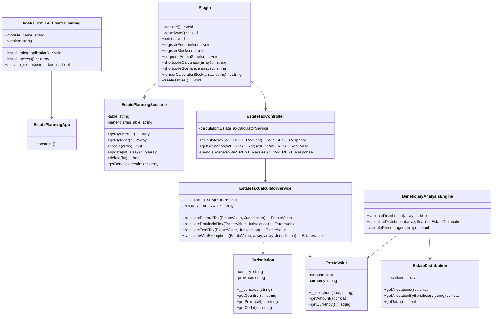
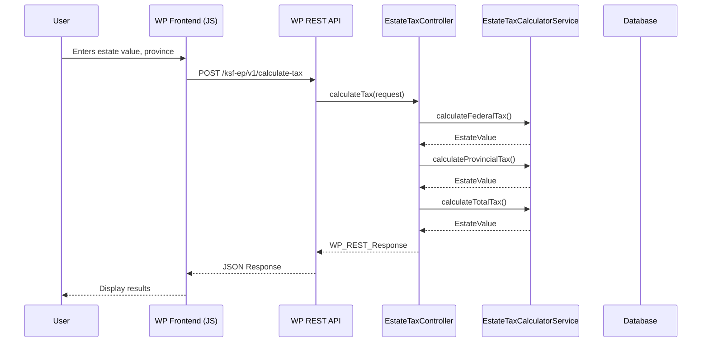
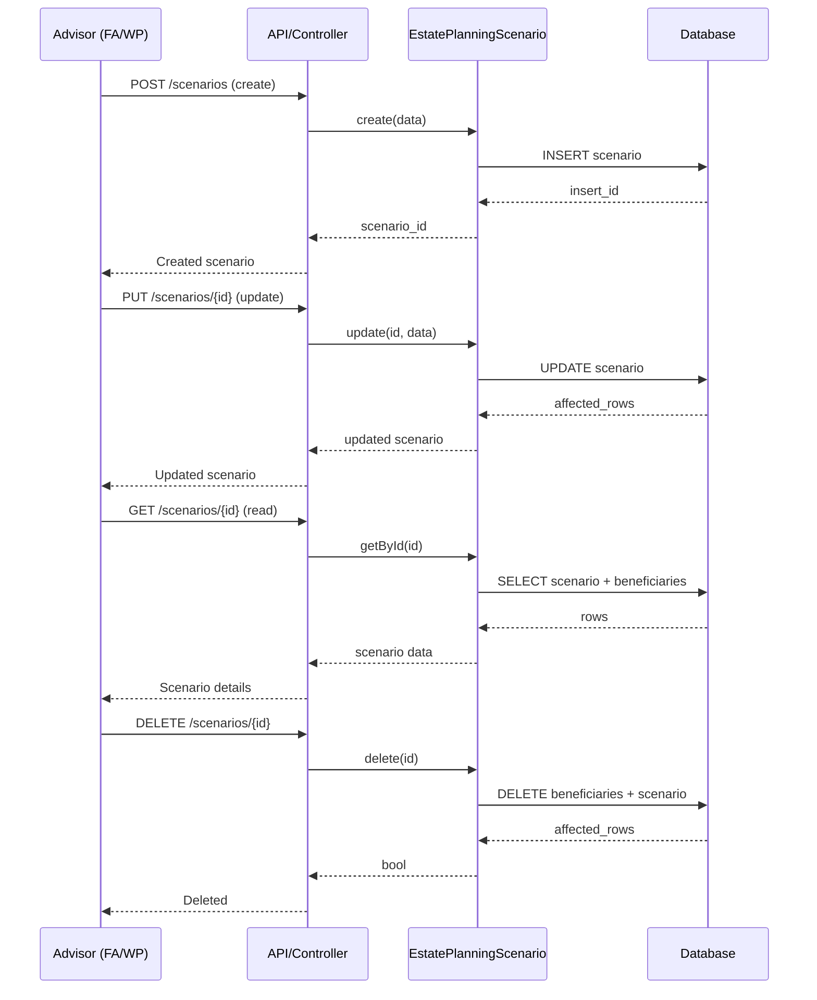
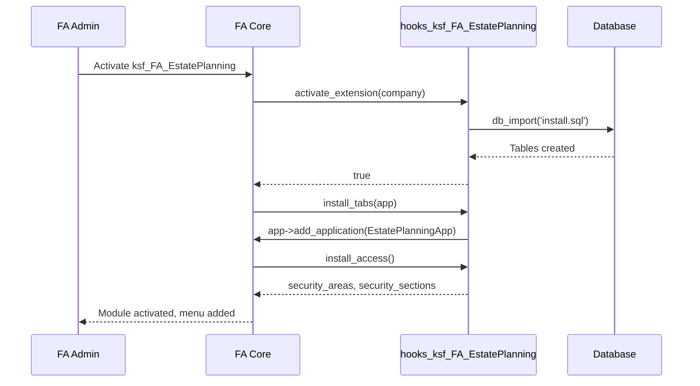
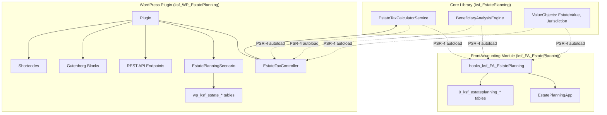
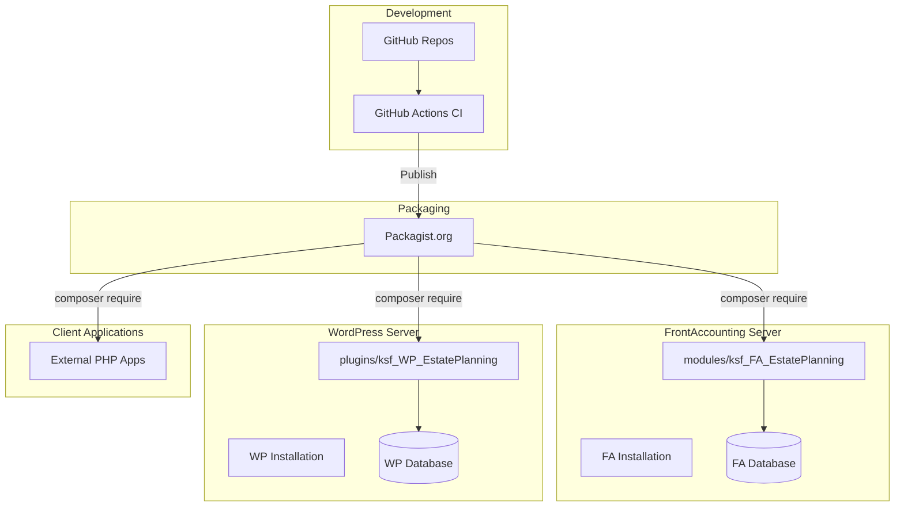
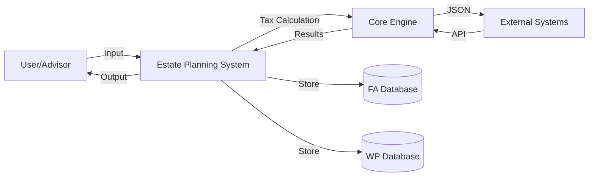
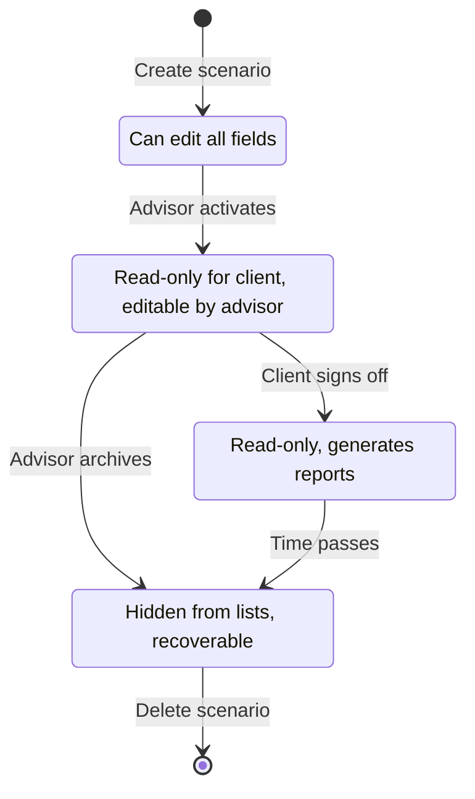

# UML Documentation

## Class Diagram



## Sequence Diagrams

### Tax Calculation Flow (WordPress)



### Scenario Management Flow



### FA Module Activation Flow



## Component Diagram



## Deployment Diagram



## Data Flow Diagram (Level 0)



## State Diagram - Estate Planning Scenario



## Package Diagram

```mermaid
packageDiagram
    package "ksfraser\\EstatePlanning" {
        package Services {
            class EstateTaxCalculatorService
            class BeneficiaryAnalysisEngine
        }
        package ValueObjects {
            class EstateValue
            class Jurisdiction
        }
        package Containers {
            class EstateApi
        }
        package Models {
            class EstateDistribution
        }
    }

    package "ksfraser\\FrontAccounting\\EstatePlanning" {
        class hooks_ksf_FA_EstatePlanning
        class EstatePlanningApp
    }

    package "ksfraser\\WP\\EstatePlanning" {
        class Plugin
        class EstateTaxController
        class EstatePlanningScenario
    }

    "ksfraser\\FrontAccounting\\EstatePlanning" --> "ksfraser\\EstatePlanning"
    "ksfraser\\WP\\EstatePlanning" --> "ksfraser\\EstatePlanning"
```

---

*Generated for Estate Planning Modules v1.0.0*